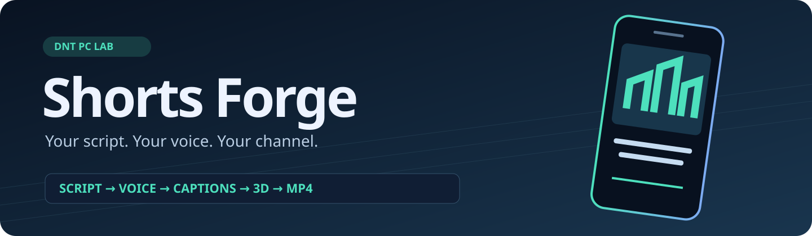
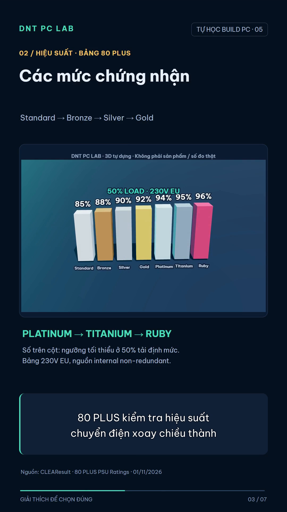
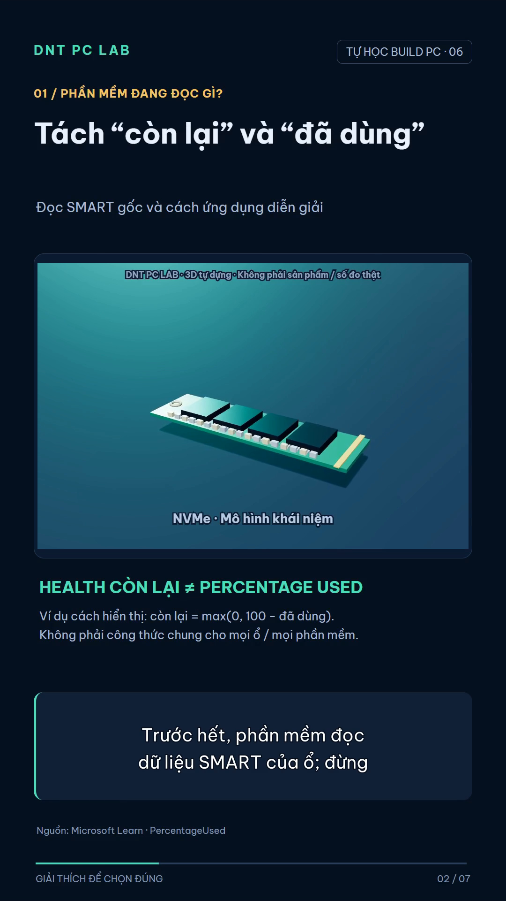
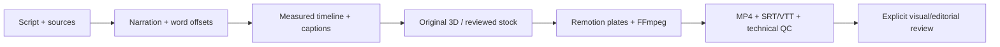

<p align="center"></p>

<h1 align="center">Shorts Forge</h1>
<p align="center"><b>Your script. Your voice. Your channel. One reproducible workflow.</b><br>Build narrated vertical videos with aligned captions, original 3D and reviewed B-roll.</p>
<p align="center"><a href="README.vi.md">Tiếng Việt</a> · <a href="#quick-start">Quick start</a> · <a href="docs/agent-workflow.md">Agent workflow</a> · <a href="docs/broll.md">Pixabay / Pexels</a> · <a href="LICENSE">MIT code</a></p>
<p align="center"><a href="https://github.com/carrot1301/shorts-forge/actions/workflows/ci.yml"></a></p>

Born from the workflow behind **DNT PC LAB**. This is the reusable production pipeline: narration with actual word offsets, captions, Three.js models, Remotion scene plates, FFmpeg encoding and measurable quality checks. Bring an idea and edit a JSON script; use your coding agent to help research and author it.

<table><tr><td width="50%"></td><td width="50%"></td></tr></table>

[Watch the 16-second showcase](docs/assets/showcase.mp4). The screenshots and showcase use the original DNT PC LAB branding; generated projects have a configurable channel name.

## What you get

- **Narration + real timing:** Vietnamese-first Edge TTS, or import your own audio and actual aligned word offsets. No guessed subtitle timing or audio stretching.
- **Two-line captions:** burned into the video, plus SRT/VTT files.
- **Seven original 3D scenes:** abstract blocks, PSU, efficiency tiers, energy flow, NVMe, NAND/spare blocks and backup. Perspective, shading and motion; editable Three.js geometry.
- **Real B-roll workflow:** Pixabay/Pexels discovery, 24-hour API cache, local preview frames, explicit visual/license review and hash checks before integration.
- **Portable projects:** channel branding, script and voice settings in `project.json`; no workstation junctions.
- **Technical QC:** full decode, 1080×1920 / 30 fps, AAC, loudness, narration correlation, actual caption pixel bounds and review frames.
- **Agent-ready instructions:** [`AGENTS.md`](AGENTS.md), a [skill](.agents/skills/shorts-forge/SKILL.md), writing prompts and a review checklist.

## Quick start

Install **Node.js 22.13+**, **FFmpeg/FFprobe** and **Git**. FFmpeg must include `libx264`, `libass` and `drawtext` support. See [setup and troubleshooting](docs/setup.md).

```bash
git clone https://github.com/carrot1301/shorts-forge.git
cd shorts-forge
npm ci
npx playwright install chromium
npm run doctor
npm run demo
```

Open **`projects/demo/delivery/video.mp4`**. The demo contains a short recorded narration and real word offsets, so it needs **no API key, no TTS request and no paid AI account**. Installation still downloads npm packages and a browser; after setup the demo renders locally.

Windows PowerShell blocks `npm.ps1` on some machines: use `npm.cmd` / `npx.cmd`. Linux may need `npx playwright install --with-deps chromium`.

## Make your own short

```bash
npm run forge -- init projects/my-short --template starter
# Edit projects/my-short/project.json
npm run forge -- build projects/my-short
```

Templates: **`starter`**, **`power`** (80 PLUS), **`ssd`** (NVMe health), **`demo`** (offline).

```json
{
  "schema_version": 1,
  "title": "My first explainer",
  "brand": "YOUR CHANNEL",
  "series": "EXPLAINED",
  "number": 1,
  "narration": {
    "mode": "edge",
    "voice": "en-US-AriaNeural",
    "rate": "+15%"
  },
  "parts": [
    {
      "id": "hook",
      "eyebrow": "ONE CLEAR IDEA",
      "heading": "Turn an idea into a short",
      "sub": "Explain one thing at a time",
      "model": "abstract",
      "big": "START WITH A QUESTION",
      "detail": "Use an example your audience can understand.",
      "source": "Your original script",
      "text": "A useful short starts with one clear idea. Ask a question your audience cares about, then explain it with a simple example."
    }
  ]
}
```

`text` is spoken. Other text fields appear on screen. Start with short paragraphs; the actual narration determines the timeline. The default pipeline accepts up to 180 seconds of narration and adds a one-second end hold. The PC models include Vietnamese labels; edit `src/models/scene.html` to localize them. English scripts and neural voices can be configured as above.

Want an agent to help? Paste the prompt in [agent-workflow.md](docs/agent-workflow.md). This repository does not include an LLM API client or automatic factual verification; use your preferred agent and review its work.

## Use your own narration

Set `narration.mode` to `import`, with project-relative `audio` and `words` files. Word records contain `{ "text": "Hello", "start": 0.1, "end": 0.5, "scene": "hook" }`. Use real word alignment from your recorder, TTS or transcription tool. The importer verifies transcript order and timing; it does not invent offsets or transcribe audio. See [`examples/demo`](examples/demo).

## Add Pixabay / Pexels footage

Copy `.env.example` to `.env`, then enter **your own** key. `.env`, `projects/`, `cache/` and downloaded stock are ignored by Git.

```bash
npm run forge -- voice projects/my-short
npm run forge -- broll plan projects/my-short
# Inspect/edit broll/plan.json: English queries, claim type and exact-model needs.
npm run forge -- broll discover projects/my-short --provider pixabay
# Inspect broll/review.html, actual motion and source/license pages.
# Write broll/reviews.json with evidence. No automatic approval.
npm run forge -- broll build projects/my-short
npm run forge -- build projects/my-short
```

With no approved footage, the renderer retains original models. A search hit is not proof of a product, benchmark or permission. Each stock selection currently covers one whole narration scene; split your script into smaller scenes for shorter cuts. Stock is kept silent and contained in the illustration panel, with a source label. See [the complete guide](docs/broll.md) and [review schema](docs/broll-review-schema.md).

## Outputs and review

```text
projects/my-short/
  project.json              Your editable script and branding
  release/                  Narration, word offsets and caption provenance
  broll/                    Private stock work, if enabled
  qc/review.html            Video + frames for actual inspection
  qc/review.template.json   Starts as needs_review
  delivery/
    video.mp4               1080×1920, 30 fps, H.264/AAC
    captions.srt
    captions.vtt
    timeline.json
    credits.md
    qc.json                 Technical results; visual review stays pending
```

Watch the full video and audio, inspect images, claims and credits. Copy `qc/review.template.json` to `qc/review.json`, record your actual observations, reviewer/date and explicit decisions. Then run:

```bash
npm run forge -- verify projects/my-short
```

Verification checks the review record against current hashes. It cannot know whether someone actually watched the video. **Nothing in this repository automatically publishes to YouTube, TikTok or any account.**

## How it works



Run stages separately with `voice`, `models`, `plates`, `render`, `qc` and `verify`. `build` runs voice through technical QC sequentially. `render` writes to a temporary MP4 and replaces the final file after completion; a project lock prevents simultaneous renders. Do not run QC during rendering.

## Development

```bash
npm test
npm run check:public
```

Tests exercise transcript alignment, unsafe paths, subtitle formatting and real FFmpeg processing of synthetic stock fixtures. They never approve a fixture for a real render. CI runs Windows/Linux tests and a Linux demo render.

## License and attribution

Repository code and original concept geometry: [MIT](LICENSE), by **carrot1301 / DNT PC LAB**. Be Vietnam Pro is [SIL OFL](public/OFL.txt). Dependencies keep their own licenses; **Remotion has separate license eligibility**, so check the [official terms](https://www.remotion.dev/docs/license/pricing) for your use. Edge Read Aloud access is service-dependent and can fail or change; import your own aligned narration if unavailable. Provider keys, footage rights and service access are not granted by this repository. [Third-party notices](THIRD_PARTY.md).

Built a short with it? Share your result in an issue with your own media and sources. Contributions for new original model scenes, themes, languages and voice providers are welcome. If the workflow saves you time, a star helps others find it.
